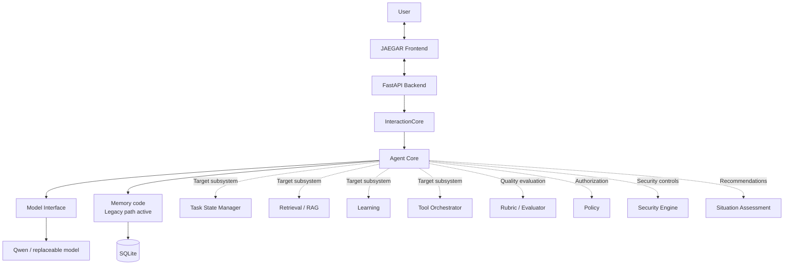

# JAEGAR Agent Guidance

> **Work in progress:** JAEGAR's architecture, implementation, and capabilities are actively evolving. This `AGENTS.md` is a living, incomplete document and must evolve alongside the project.

This file is the operational entry point for AI coding agents working in this repository. The project owner sets product direction and approves consequential architectural decisions. Treat this document and architectural notes as guidance, not proof that a described subsystem is implemented.

## Project overview

JAEGAR is a personal desktop assistant intended to be local-first, modular, replaceable, and cross-platform (macOS and Windows). The current repository is an early work in progress; do not describe the long-term vision as current capability.

## Repository map and current stack

- `frontend/`: React 19, TypeScript, and Vite interface.
- `frontend/src-tauri/`: Tauri 2 desktop shell and Rust entry points.
- `backend/`: Python FastAPI application.
  - `agentInteraction/`: validates incoming text interactions.
  - `agentCore/`: agent orchestration and current response/memory flow.
  - `modelCore/`: model interface and Qwen/MLX implementation.
  - `agentMemory/`: legacy and structured SQLite memory code.
- `docs/`: architecture, roadmap, UI, features, and development diary.

The current text request path is:

`frontend Interaction Manager → JaegarAgent HTTP client → FastAPI /message → InteractionCore → JaegarAgent → QwenModel`

The frontend dev server uses port `1420`; the backend API uses port `8000`. They are separate processes and both must be running to send a message from the desktop UI. Backend startup loads the configured local model.

### Architecture at a glance

Solid arrows show the current text/model/memory path. Dashed arrows show intended connections to subsystems that are not implemented.



This is a high-level guide, not a rigid contract for every arrow or edge case. The detailed action and memory workflows in `docs/architecture.md` are also architectural direction, not proof that those flows are implemented.

## Implementation status

### Implemented in the repository

- Typed text input, conversation display, and frontend interaction states (`IDLE`, `THINKING`, `RESPONDING`, `ERROR`).
- HTTP communication from the frontend to the FastAPI `/message` endpoint.
- Backend text validation and coordination through `InteractionCore`.
- A model interface and a Qwen implementation using MLX. The current agent loads `models/qwen3.5-9b-mlx`; do not assume this setup works on Windows or other hardware.
- SQLite legacy memory storage and structured memory tables/code. Structured records support ownership scopes, STM/LTM placements, append-only versions, relationships, and source records.
- Four focused memory test scripts under `backend/agentMemory/`.
- A basic Tauri shell. Its current Rust command is the template `greet` command.

### Not implemented or not verified as implemented

- Policy/authorization, Rubric/evaluation, Security Engine, Task State Manager, RAG, Unified Learning Framework, tool execution, and proactive recommendation systems. These appear in the target architecture but are not implemented as corresponding subsystems in the current code.
- The structured memory approval workflow. An approvals table exists, but an approval lifecycle/API (including expiry and execution-time validation) is not implemented. Structured memory operations are not wired into the Agent Core's active memory path.
- The active Agent Core memory path still extracts into and retrieves from the legacy `memories` table. Do not claim that the structured memory design governs current conversations.
- Voice integration and native audio capture are out of scope unless the project owner explicitly brings them back into scope. A microphone usage description alone is not voice functionality.
- Cross-platform model support and Windows packaging. The target architecture is not implemented end to end; some of its boundaries and flow are already represented in the current text path.

`docs/architecture.md` describes the current high-level architectural direction and should guide how new work fits together. Its diagrams are not an inventory of implemented modules or a rigid contract for every arrow, interface, branch, or edge case; those details are still evolving. Verify source before describing implementation status or refining a detailed flow. `docs/roadmap.md` may lag behind the current code. Keep “implemented,” “tested,” “decided,” “planned,” and “experimental” distinct in code and documentation.

## Architectural principles

These are design constraints and goals; they do not imply that the corresponding subsystem exists:

- Keep model inference, Agent Core coordination, interaction, quality evaluation, authorization/policy, persistence, and execution as distinct responsibilities.
- A model proposal or confidence score never grants authority. Quality evaluation and permission checks are separate. Recommendations do not authorize actions.
- Do not infer user permission. Require explicit approval for consequential actions; fail closed when authorization is unavailable or unclear.
- Keep task-specific information isolated. Cross-scope reuse must preserve provenance and respect access restrictions.
- Memory ownership scopes are Global, Project, Personal, and Conversation. STM/LTM are independent retention dimensions. Preserve provenance and history; do not silently promote, rewrite, or delete important memory.
- Learning must be validated and must never increase authority or weaken safeguards.
- Keep components replaceable and prefer local operation where practical.
- Text and voice should ultimately share the same interaction and agent pathway. Native audio and a shared cross-platform audio interface remain future design work, not current implementation.

## Working instructions

- Act primarily as a tutor: explain relevant concepts, existing behavior, why proposed code works, and important trade-offs. Code examples and implementation help are welcome.
- Before changing application code, present the proposed approach and reasoning, then pause for the project owner's review, questions, and additional requirements. Do not treat a request to explain or generate sample code as permission to edit files. An explicit request to implement a clearly scoped change is approval to proceed with that change.
- Inspect relevant source, tests, and `git status` before editing. Preserve all unrelated and uncommitted changes.
- Make focused, incremental changes; follow existing patterns and avoid unnecessary dependencies or abstractions.
- Do not modify `backend/agentCore/core.py`, `docs/architecture.md`, or memory implementation/schema without the project owner's explicit approval.
- Research uncertain technical choices and explain material trade-offs. Ask before consequential changes to architecture, data formats, permissions, or user-facing behavior.
- Add or update focused tests for behavior changed. Run the smallest relevant validation and report exactly what passed or failed. Do not claim reliability or cross-platform support based on a build or a single-platform test.
- Never stage, commit, push, delete user data, or run destructive Git operations without explicit approval.
- Do not create additional documentation unless it has clear value and an agreed scope. Keep this file concise and update it when verified project facts change.

## Development and validation commands

Run commands from the repository root unless noted:

```sh
.venv/bin/uvicorn backend.main:app --reload
```

Run the desktop UI in another terminal:

```sh
cd frontend
npm run tauri dev
```

The backend must finish loading its local model before submitting a message. The frontend calls `http://localhost:8000/message`; the Tauri dev URL is `http://localhost:1420`.

Frontend type-check and production asset build:

```sh
cd frontend
npm run build
```

Focused memory tests (assertion-based; schema/persistence tests use temporary databases):

```sh
.venv/bin/python -m backend.agentMemory.test_memory
.venv/bin/python -m backend.agentMemory.test_contextBuilder
.venv/bin/python -m backend.agentMemory.test_schema
.venv/bin/python -m backend.agentMemory.test_persistence
```

There is no frontend test script or tracked Python dependency manifest at the time of this draft. Check the manifests before assuming other commands or dependencies.
